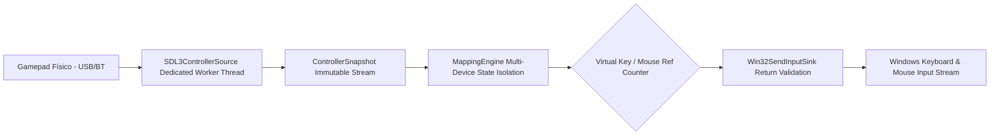

# 🏛️ Arquitetura do Sistema — OpenPad

## 1. Visão Geral do Pipeline de Entrada

O **OpenPad** opera desacoplando a camada física de hardware da camada de injeção de comandos do Windows:

---

## 2. Componentes Principais

### 2.1 `SDL3ControllerSource`
- Responsável por inicializar a SDL3 Gamepad API (`SDL.InitFlags.Gamepad`).
- Executa polling em thread de trabalho (`OpenPad.SDL3Worker`) com prioridade `AboveNormal`.
- Converte eventos e eixos em estruturas imutáveis `ControllerSnapshot`.
- Trata conexão e desconexão em tempo de execução com resiliência a exceções.

### 2.2 `MappingEngine`
- **Isolamento de Estado por Dispositivo (`DeviceInputState`)**:
  - Cada controle conectado possui seu próprio dicionário de botões anteriores, gatilhos analógicos e estados de turbo.
  - Elimina a contaminação cruzada onde o evento de um jogador alterava o estado do outro.
- **Contagem de Referências (`_virtualKeyRefCounts`, `_mouseButtonRefCounts`)**:
  - Quando múltiplos controles têm botões mapeados para a mesma tecla de saída (ex: Barra de Espaço), o primeiro disparo envia `KeyDown`. O segundo controle apenas incrementa a referência.
  - O evento `KeyUp` só é emitido quando o último controle solta o botão.
- **Desconexão Segura e Desarme**:
  - A desconexão de um controle libera exclusivamente as teclas daquele dispositivo, sem interromper o jogo dos demais controles ativos.
  - O desarme do motor libera imediatamente todos os inputs registrados em nível de SO.

### 2.3 `Win32SendInputSink`
- Invoca a API Win32 nativa `SendInput()`.
- **Validação de Retorno**: Verifica se `SendInput` retornou o número exato de eventos inseridos.
- **Detecção de Erros de Privilégio (UIPI)**: Captura `Marshal.GetLastWin32Error()` caso `SendInput` retorne zero (ex.: janela de jogo com integridade mais alta ou tela de bloqueio).
- **Injeção Nativa para Testes**: Permite injetar delegates customizados em testes unitários para simular recusas de input pelo sistema operacional.

---

## 3. Componentes Experimentais (Fora do MVP)

Os módulos abaixo estão implementados em código para pesquisa e arquitetura futura, mas não integram o fluxo principal de produção do MVP:

1. **`VirtualBusDriverBridge`**: Gera relatórios de gamepad virtual, mas requer a instalação e assinatura de drivers de terceiros (ViGEmBus) que estão fora do escopo do executável autocontido.
2. **`OpenPadMicrokernel`**: Estrutura de buffer circular e pacotes IPC em memória, sem gancho direto em anel de privilégio do kernel.
3. **`ProfileCloudSyncEngine`**: Mecanismo de assinatura HMAC-SHA256 para perfis comunitários, sem serviço remoto atrelado.
4. **`OnScreenDisplayOverlay`**: Modelagem de telemetria HUD, sem gancho direto na swapchain do DirectX/Vulkan.
